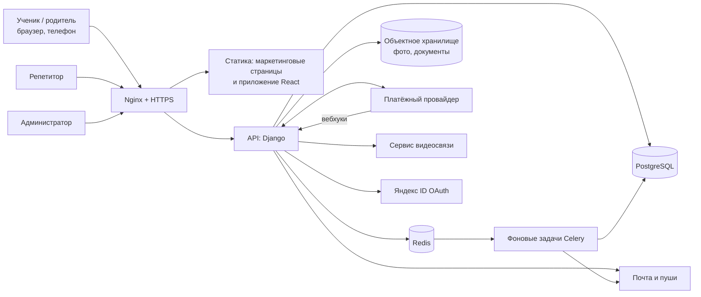
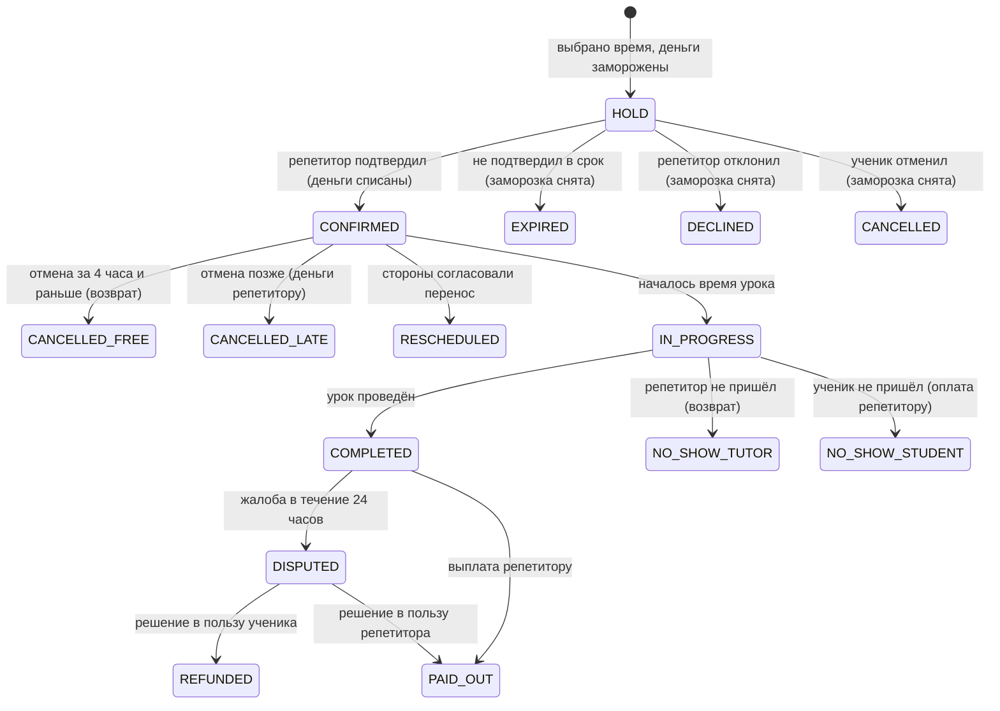

# TopRepet: план обновления сервиса и архитектура

Документ описывает, как превратить текущий сайт в сервис из макетов: каталог репетиторов, самостоятельная запись, оплата с заморозкой, заявки, чат, уроки, отзывы, кабинеты ученика и репетитора. Сроки и объёмы ориентировочные, их нужно уточнить после выбора команды и платёжного провайдера.

## 1. Исходная точка и разрыв

**Сейчас (по репозиторию и README).**
- Одностраничное React-приложение на Vite с предварительной отрисовкой (`scripts/prerender.mjs`) ради SEO, хостинг статический (`public/CNAME` = `toprepet.ru`).
- Каталог репетиторов и занятий зашит в код (`src/entities/teacher/model/catalog.ts`), цена одна на всех (`1 200 ₽`), промокоды, запись через менеджера в мессенджерах.
- Блог живёт отдельно (репозиторий `toprepet-blog`, Next.js, Supabase) и подтягивается снимком (`src/blog/snapshot.json`).
- Нет пользователей, аккаунтов, базы, платежей, чата, расписания.

**Нужно по макетам (около 240 экранов, телефон и компьютер, три роли: ученик, репетитор, администратор).**
- Аккаунты (почта и пароль, Яндекс ID), онбординг, роли.
- Каталог с поиском и фильтрами, анкеты, избранное.
- Расписание репетитора, самостоятельная запись, серии занятий, перенос и отмена.
- Цена репетитора и сбор сервиса 10%, заморозка денег, списание после подтверждения, выплаты.
- Заявки учеников с откликами репетиторов, чат, видеоурок, отзывы, споры, поддержка, уведомления.
- Админка для модерации анкет и отзывов, споров, выплат.

Бесплатное знакомство (20 минут, один раз для пары) остаётся. Промокоды и менеджер из сценария убираются.

## 2. Ключевые решения

| Вопрос | Решение | Почему |
|---|---|---|
| Структура бэкенда | Модульный монолит | Команда небольшая, денежная логика проще держать в одной транзакции |
| Язык и фреймворк | Python, Django, Django REST Framework (или Django Ninja) | Готовая админка для споров и модерации, зрелая авторизация, очереди |
| База данных | PostgreSQL | Транзакции, ограничения целостности, полнотекстовый поиск |
| Фоновые задачи | Celery + Redis (на тестовом сервере можно начать с cron и очереди в БД) | Автоотмена, напоминания, выплаты |
| Фронтенд | Существующее React-приложение, расширенное маршрутами кабинетов | Не выбрасывать готовые страницы и SEO |
| Контракт API | OpenAPI-схема, типы для фронтенда генерируются автоматически | Меньше расхождений между макетами, API и интерфейсом |
| Чат | Сначала простой (запросы с периодическим опросом), затем WebSocket | Не усложнять первый релиз |
| Видеоуроки | Готовый сервис (LiveKit, Jitsi, Яндекс Телемост или аналог) | Своё видео не писать. Конкретный выбор нужно проверить по цене и условиям |
| Платежи | Провайдер с поддержкой маркетплейса и выплат (ЮKassa «Безопасная сделка», Т-Банк, CloudPayments) | Заморозка, расщепление платежа, выплаты исполнителям |
| Хостинг | Серверы и базы в России | 152-ФЗ: данные граждан РФ хранятся в РФ |

Если команда сильнее в TypeScript, можно взять NestJS и PostgreSQL. Архитектура ниже от этого почти не меняется, но админку для споров и модерации придётся писать самим.

## 3. Общая схема



**Разделение сайта и приложения.**
- Публичные страницы (главная, каталог, анкеты, блог, документы) остаются с предварительной отрисовкой ради поиска. Каталог и анкеты теперь строятся из API, а не из файла в коде.
- Кабинеты (после входа) работают как приложение: данные грузятся из API, индексировать их не нужно.
- Блог (`toprepet-blog`, Supabase за пределами РФ) нужно перенести в основной бэкенд или на российский хостинг, иначе он нарушает требование о хранении данных. Для статей это менее критично, чем для пользователей, но админка блога содержит учётные записи авторов.

## 4. Модули бэкенда

Каждый модуль имеет свои модели, сервисный слой и API. Модули общаются через вызовы сервисов и события, а не через чужие таблицы напрямую.

| Модуль | Отвечает за | Экраны макетов |
|---|---|---|
| `accounts` | Регистрация, вход, Яндекс ID, роли, сброс пароля, подтверждение почты, согласия | вход, регистрация, онбординг, профиль, выход |
| `tutors` | Анкета, предметы, образование, опыт, документы, модерация, цена, публикация | мастер анкеты (4 шага), превью, публикация, документы |
| `catalog` | Поиск и фильтры, подсказки, избранное | каталог, подсказки, пустая выдача, избранное |
| `availability` | Рабочие часы репетитора, исключения, свободные окна | недельное расписание, выбор времени |
| `bookings` | Запись, серии, подтверждение, перенос, отмена, неявка | запись, подтверждение, ожидание, перенос, отмена, серии |
| `payments` | Заморозка, списание, возвраты, регистр движения денег, выплаты, карты | оплата, ошибка оплаты, платежи, выплаты, финансы репетитора |
| `requests` | Заявки учеников, отклики репетиторов, выбор отклика | создание заявки, отклики, заявки для репетитора |
| `messaging` | Диалоги, сообщения, вложения, предупреждение о контактах, жалобы | чаты, диалог, первое сообщение |
| `lessons` | Карточка урока, комната видеосвязи, статусы, итог урока | мои уроки, урок идёт, урок завершён |
| `reviews` | Отзывы после оплаченных уроков, модерация, ответы | отзыв, статус отзыва, отзывы репетитора |
| `disputes` | Жалобы на урок в течение 24 часов, решения, возвраты | проблема с уроком, спор, спор у репетитора |
| `notifications` | Центр уведомлений, письма, настройки | уведомления ученика и репетитора, письма |
| `content` | Блог, документы, справка | блог, статья, документы, помощь |
| `adminpanel` | Модерация анкет и отзывов, споры, выплаты, блокировки | служебные экраны |

## 5. Модель данных (основные сущности)

```
User(id, email, password_hash | yandex_id, role[student|tutor|admin], name, status, created_at)
StudentProfile(user_id, city, timezone, notification_settings)
TutorProfile(user_id, slug, photo, headline, about, education, experience_years,
             subjects[], price_rub, status[draft|review|published|hidden], intro_lesson_enabled)
TutorDocument(id, tutor_id, kind, file, status)
Subject(id, name, group), TutorSubject(tutor_id, subject_id, levels)
AvailabilityRule(tutor_id, weekday, start, end), AvailabilityException(tutor_id, date, start, end, kind)
Favorite(student_id, tutor_id)

Booking(id, student_id, tutor_id, subject_id, starts_at, duration_min, kind[intro|regular],
        series_id, status, price_tutor, price_student, fee, confirm_deadline, created_at)
BookingSeries(id, student_id, tutor_id, rule, count)
Payment(id, booking_id, provider_id, amount, status[hold|captured|refunded|failed])
LedgerEntry(id, account, booking_id, amount, kind, created_at)   -- двойная запись, не изменяется
Payout(id, tutor_id, amount, status, requested_at, paid_at)
Card(id, user_id, provider_token, last4)

Request(id, student_id, subject, level, budget, description, status, expires_at)
RequestResponse(id, request_id, tutor_id, price, slots, message, status)

Conversation(id, student_id, tutor_id, request_id?), Message(id, conversation_id, sender_id, body, attachments, flags)
LessonRoom(id, booking_id, provider_room_id, started_at, ended_at)
Review(id, booking_id, student_id, tutor_id, rating, text, status[pending|published|rejected])
Dispute(id, booking_id, opened_by, reason, status, resolution, refund_amount)
Notification(id, user_id, kind, payload, read_at), AuditLog(id, actor, action, object, at)
```

Правила целостности, которые нужно закрепить на уровне БД, а не только в коде:
- у репетитора не может быть двух активных записей на пересекающееся время (ограничение на непересекающиеся интервалы);
- бесплатное знакомство одно на пару ученик и репетитор (уникальный индекс по условию);
- запись в журнале денег никогда не обновляется и не удаляется.

## 6. Жизненный цикл записи



Все переходы выполняются одним сервисным методом внутри транзакции: смена статуса, запись в журнал денег, событие для уведомлений. Прямого изменения статуса из API нет.

Бесплатное знакомство проходит по тому же графу, но без оплаты.

## 7. Деньги

- Репетитор задаёт цену `P` и получает её полностью. Ученик платит `P × 1,10`. Сбор сервиса `0,10 × P` хранится отдельной проводкой.
- Пример из макета: 2 000 ₽ репетитору, 2 200 ₽ ученику.
- При записи на карте ученика замораживается `P × 1,10`. После подтверждения репетитором списывается, после проведённого урока (и окна для жалобы) выплачивается репетитору.
- Журнал денег ведётся по двойной записи: счета «ученик», «заморозка», «репетитор к выплате», «сервис». Сумма по журналу всегда сходится в ноль, это проверяется ночной задачей сверки.
- Отдельный вопрос для юриста и бухгалтера до выбора провайдера: статус репетиторов (самозанятые, ИП), кто выдаёт чеки, как оформляется договор оферты, возможен ли «агентский» режим.
- Данные карт нигде не хранятся, только токены провайдера.
- Вебхуки провайдера проверяются по подписи и обрабатываются идемпотентно (повтор того же события не меняет результат).

## 8. API и реалтайм

REST под `/api/v1`, JSON, авторизация по сессионным cookie (с защитой от подделки запросов) для веб-клиента.

Примеры групп:
- `POST /auth/register`, `/auth/login`, `/auth/yandex`, `/auth/password-reset`
- `GET /tutors?subject=&price_max=&when=&sort=`, `GET /tutors/{slug}`, `GET /tutors/{slug}/slots?from=&to=`
- `POST /bookings`, `POST /bookings/{id}/confirm|decline|cancel|reschedule`
- `GET /me/lessons`, `GET /me/payments`, `POST /me/cards`
- `POST /requests`, `GET /requests/{id}/responses`, `POST /requests/{id}/responses/{rid}/accept`
- `GET /conversations`, `POST /conversations/{id}/messages`
- `POST /disputes`, `POST /reviews`

Чат и уведомления: сначала опрос раз в несколько секунд, затем WebSocket (Django Channels или отдельный сервис). Видеокомната создаётся по записи, ссылка доступна только участникам и только в окне урока.

## 9. Безопасность и соответствие требованиям

- **152-ФЗ**: серверы и базы в России, согласие на обработку данных при регистрации, политика, возможность удалить аккаунт, уведомление Роскомнадзора как оператора данных (уточнить у юриста).
- **Права доступа**: у каждой выборки проверяется, что пользователь участвует в записи, чате или заявке. Это покрывается автоматическими тестами для каждой роли.
- **Контакты в чате**: переписка проверяется на номера и ссылки на мессенджеры, показывается предупреждение (экран «contactwarn» в макетах), нарушения идут на модерацию.
- **Защита**: ограничение частоты запросов на вход и сообщения, проверка загружаемых файлов (тип и размер), хэширование паролей, заголовки безопасности, журнал действий администраторов.
- **Резервные копии**: ежедневный дамп базы с хранением за пределами сервера и регулярной проверкой восстановления.

## 10. Инфраструктура

| Среда | Где | Назначение |
|---|---|---|
| Локальная | Docker Compose (Django, PostgreSQL, Redis) | Разработка |
| Тестовая | Бесплатный сервер Reg.cloud (1 ядро, 1 ГБ, 10 ГБ) | Проверка деплоя, демонстрации, **только тестовые данные**, платежи в тестовом режиме |
| Рабочая | Российский провайдер (Timeweb Cloud, Selectel, Yandex Cloud, VK Cloud): минимум 2 ядра, 4 ГБ, 40–50 ГБ, управляемая PostgreSQL с бэкапами | Реальные пользователи |

На тестовом сервере с 1 ГБ памяти нужен swap, один процесс gunicorn с 1–2 воркерами, PostgreSQL с урезанными настройками, Nginx. Redis и Celery добавлять по необходимости.

Деплой: GitHub Actions собирает образ, прогоняет тесты и линтеры, по ветке `main` выкладывает на тестовую среду, рабочая выкладывается вручную по тегу. Мониторинг: логи с ротацией, отслеживание ошибок (например Sentry или российский аналог), проверка доступности, метрики очередей. Яндекс Метрика остаётся (`scripts/verify-analytics.mjs`).

## 11. Фронтенд

1. Вынести дизайн-токены из макетов (цвета, скругления, стеклянные панели, шрифт Manrope, анимации) в единый слой стилей приложения.
2. Собрать библиотеку компонентов по макетам: кнопки, поля, карточка репетитора, ряд занятий, плашки статусов, шторка, модальное окно, панель действий, вкладки.
3. Добавить маршруты кабинетов. Каждый экран макета соответствует маршруту. Ссылки в макетах (`href`) уже соответствуют будущим адресам.
4. Заменить зашитый каталог запросами к API, сохранив предварительную отрисовку публичных страниц.
5. Состояния загрузки, пустые экраны и ошибки уже нарисованы в макетах, их нужно подключать к каждому запросу.
6. Удалить промокоды (`src/features/promo-code`, `PROMO_PRICE`) и сценарий записи через менеджера из мессенджеров, когда запустится самостоятельная запись.

## 12. План по этапам

Оценки даны для 1–2 разработчиков и могут сильно меняться.

| Этап | Содержание | Результат | Оценка |
|---|---|---|---|
| 0. Подготовка | Решения по платёжному провайдеру, юридическая схема, согласование состава первой версии, репозиторий бэкенда, Docker, CI, тестовый сервер | Каркас и окружения | 1–2 недели |
| 1. Аккаунты и анкеты | Регистрация, вход, Яндекс ID, роли, мастер анкеты, модерация, загрузка фото, перенос текущих 11 репетиторов | Репетитор может создать анкету, администратор её опубликовать | 3–4 недели |
| 2. Каталог | Поиск, фильтры, анкета, избранное, SEO публичных страниц из API | Новый каталог вместо зашитого | 2–3 недели |
| 3. Запись без оплаты | Расписание, свободные окна, запись, подтверждение и отклонение репетитором, бесплатное знакомство, уведомления, мои уроки | Полный сценарий «запись → подтверждение» | 3–4 недели |
| 4. Деньги | Платёжный провайдер, заморозка, списание, журнал, возвраты, отмены и переносы, выплаты, сверка | Реальные платные занятия | 4–6 недель |
| 5. Общение и уроки | Чат, предупреждения о контактах, видеокомната, итог урока, отзывы, споры | Занятия проходят внутри сервиса | 3–4 недели |
| 6. Заявки и серии | Заявки учеников, отклики, серии занятий, подписки на уведомления | Расширенные сценарии | 2–3 недели |
| 7. Запуск | Перенос блога, нагрузочная проверка, резервные копии, пилот с несколькими репетиторами, переключение домена | Публичный запуск | 2–3 недели |

Этапы 1–3 можно показывать пользователям без денег (в режиме тестирования), этап 4 включать только после юридической проверки.

## 13. Риски

- **Платежи и налоги.** Самое длинное и неочевидное по срокам. Начинать с переговоров с провайдером на этапе 0.
- **Данные за рубежом.** Supabase блога находится за пределами РФ, а будущие аккаунты и переписка пользователей должны храниться в РФ.
- **Пустой каталог.** Сервис полезен, когда у репетиторов есть расписание и цена. Нужен план привлечения репетиторов, иначе записываться не к кому.
- **Видео.** Бесплатные решения могут не подойти по качеству и ограничениям, проверить до этапа 5.
- **Объём макетов.** Около 240 экранов, интерфейс лучше внедрять по маршрутам и этапам, а не целиком.
- **Тестовый сервер.** Бесплатный период ограничен 2 месяцами, срок не продлевается при пересоздании. Деплой должен быть воспроизводимым скриптом.

## 14. Что нужно решить в начале

1. Платёжный провайдер и юридическая схема (самозанятые, договор, чеки).
2. Состав первой версии: можно ли отложить серии, заявки и видеоурок на вторую очередь.
3. Кто разрабатывает: сами, команда или подрядчик. От этого зависят язык и сроки.
4. Где живёт блог и можно ли перенести его в основной бэкенд.
5. Какие города и часовые пояса обслуживаются на старте.
